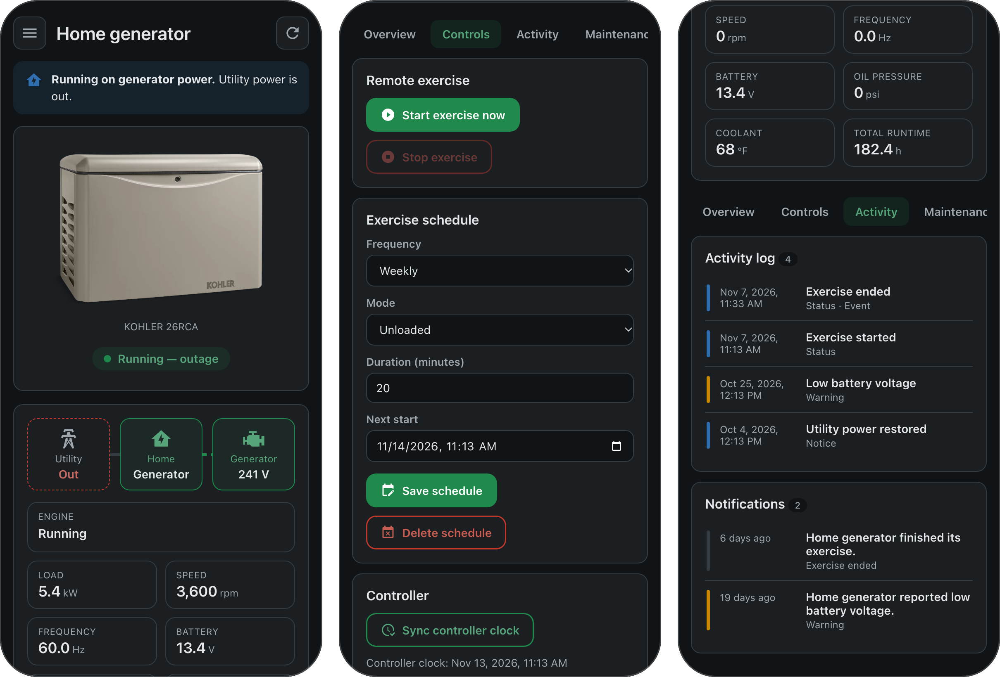

# Rehlko Energy Management for Home Assistant

[](https://hacs.xyz)
[](https://github.com/kedube/ha-rehlko/releases)
[](https://github.com/kedube/ha-rehlko/actions/workflows/test.yml)
[](https://github.com/kedube/ha-rehlko/actions/workflows/validate.yml)

[](LICENSE)

<p align="center"></p>

A Home Assistant integration and sidebar panel for **Rehlko** (formerly **Kohler**) home
standby generators — the ones managed by the **Energy Mgmt.** mobile app (previously "KOHLER
Energy Management"). It uses the same cloud API as the app to expose live telemetry, exercise
control, event and alert notifications, activity logs, maintenance history, and generator profiles.

> **Unofficial.** Built by reverse‑engineering the mobile app; not affiliated with or endorsed
> by Rehlko / Kohler. The API is private and can change without notice. See
> [docs/API.md](docs/API.md) and [docs/reverse-engineering.md](docs/reverse-engineering.md).

[Features](#features) · [What you need](#what-you-need) · [Install](#install) ·
[Set up](#set-up) · [Options](#options) · [Automating](#automating) ·
[How it works](#how-it-works) · [Development](#development) · [User guide](docs/user_guide.md)

## Features

- **A Generator sidebar panel** — manufacturer product imagery selected by generator model,
  a live status indicator (standby, running, exercising, fault, E‑Stop, offline), a live
  utility↔generator↔home power flow, operating statistics, and tabs for Overview, Controls,
  Activity, Maintenance, Profile and Diagnostics. Images for models without an exact match
  are labeled as representative.
- **Every reading as an entity.** All data the API reports becomes a Home Assistant sensor,
  binary sensor, configuration or diagnostic entity — voltages, loads, engine data, controller
  and battery, runtime totals, fuel, weather, service agreement, cellular plan, and more. A
  catch‑all adds an entity for any field without one of its own, including fields a future app
  version adds; these are created disabled, so nothing is hidden and nothing is recorded until
  you enable it.
- **Energy produced**, in kWh, for the Energy dashboard and long-term statistics. The service
  reports power, not energy, so this is estimated by adding up the load between polls.
- **Control, not just read:**
  - Start / stop an exercise now.
  - Create, edit or delete the exercise schedule (mode, frequency, duration, next start).
  - Sync the controller clock.
  - Add maintenance notes.
  - Write load‑module and PIM parameters, and rename the generator and those items — from
    entities, actions, or the panel's Profile tab.
  - Toggle the account's push/email notification categories.
- **Event notifications** on the Home Assistant bus and as `event` entities: new activity‑log
  entries, alerts raised/cleared, app notifications, and derived power events (utility lost /
  restored, generator started / stopped, load transferred).
- **A calendar** of scheduled exercises (projected forward) and maintenance due dates.
- **Services** for automations, including read‑only ones that return the activity log, alerts,
  maintenance history, notifications and raw payloads.
- **Ten languages.** The integration and the panel are translated into English, German,
  Spanish, French, Italian, Japanese, Dutch, Polish, Brazilian Portuguese and Simplified
  Chinese, and follow each user's Home Assistant language, number format, clock, time zone and
  unit system.

## What you need

- Home Assistant **2026.2** or newer.
- A Rehlko / Kohler Energy Management account (the email and password you use in the app) with
  at least one generator.
- The app's **OAuth client id, client secret and API key**. These identify the app (not your
  account) and are the same for every install. The setup form asks for them; see
  [docs/API.md](docs/API.md#authentication) for how to read them from a copy of the app
  installed on a Mac or extracted from the Android package.

## Install

This is a custom repository: it is not in the default catalogue, so searching for it by name
finds nothing until you add the repository by link. After that it installs and updates like
any other.

**Via the Marketplace (Home Assistant 2026.11 and later)**

From 2026.11, HACS is built into Home Assistant as the Marketplace. An install made through
HACS carries over and keeps getting updates, so there is nothing to redo. To add it fresh:

1. Open **Settings → Marketplace** and choose **Add from link**
2. Enter `kedube/ha-rehlko` (or the full GitHub URL) and choose **Add**
3. Install **Rehlko Energy Management**, and restart Home Assistant if a repair asks you to

**Via HACS (Home Assistant 2026.10 and earlier)**

[](https://my.home-assistant.io/redirect/hacs_repository/?owner=kedube&repository=ha-rehlko&category=integration)

That button adds this repository to HACS on your own instance and offers the download. It
needs [My Home Assistant](https://my.home-assistant.io/) set up in your browser. Otherwise:

1. Open **HACS**, open the ⋮ menu and choose **Custom repositories**
2. Add `kedube/ha-rehlko` (or the full GitHub URL) with category **Integration**
3. Search for **Rehlko Energy Management** and install it
4. Restart Home Assistant

Both install from **releases**, not from the latest commit.

**Manually**

Copy the `custom_components/rehlko_energy/` folder from this repository into the
`custom_components/` folder of your Home Assistant configuration directory, so that
`config/custom_components/rehlko_energy/manifest.json` exists, and restart.

## Set up

**Settings → Devices & Services → Add Integration → Rehlko Energy Management.** Enter your
account email and password, and expand **App credentials** to paste the client id, client secret
and API key. The integration signs in, finds your generators, and creates a device for each one
(and a sub‑device for its automatic transfer switch, when present).

The **Generator** panel appears in the sidebar automatically for Home Assistant administrators;
you can turn it off per account in the integration's options. Its route is `/rehlko-energy`
on your Home Assistant instance (for example, `http://homeassistant.local:8123/rehlko-energy`).
This is an integration panel, so install and configure the integration before opening it.
The panel and `rehlko_energy` domain actions require administrator access because they expose
raw account data and device configuration. Automations can call these actions; individual
entity controls follow Home Assistant's normal entity permissions.

## Options

Integration **Configure** lets you set:

- Polling interval in standby (default 60 s) and while running / during an outage (default 15 s).
- How often the activity log, alerts and notifications are fetched (default 120 s).
- How many notifications to fetch per generator.
- Whether to show the sidebar panel.
- Whether to create the catch‑all diagnostic entities (created disabled; enable the ones you
  want on the device page).

## Automating

Trigger on the bus events, for example:

```yaml
automation:
  - alias: Generator started on utility outage
    triggers:
      - trigger: event
        event_type: rehlko_energy_power
        event_data:
          type: generator_started
    actions:
      - action: notify.mobile_app
        data:
          title: Generator
          message: "The generator started — utility power is out."
```

Or call a service and use the response:

```yaml
action: rehlko_energy.get_activity_log
data:
  device_id: <your generator's device ID>
  limit: 20
response_variable: log
```

See [docs/user_guide.md](docs/user_guide.md) for the full list of entities, services and events.

## How it works

The integration authenticates to Rehlko's Okta tenant (OAuth 2.0 password grant + refresh
tokens) and polls the `/kem/api/v3` REST API, adapting its rate to whether the generator is
active. Writes mirror the app's own request shapes and guards (it refuses to start a generator
that is offline, not in Auto, or has the emergency stop engaged). The whole API surface and the
authentication model are documented in **[docs/API.md](docs/API.md)**.

## Development

```bash
# Python integration
python3 -m pip install -r requirements-test.txt
python3 -m pytest tests/ -q
ruff check . && ruff format --check .

# Sidebar panel (Node 22+)
cd frontend
npm install
npm run check          # lint, typecheck, test, build
npm run dev            # local production-bundle preview with simulated data and actions
```

The panel is built with Lit + Vite into `custom_components/rehlko_energy/www/`.

The picture at the top of this page is three views of that preview; with `npm run dev`
running, `scripts/build_readme_images.sh` rebuilds it.

### Translations

Nothing in `custom_components/rehlko_energy/translations/` is edited by hand:

- **English** is written in `scripts/build_translations.py`; enum state names come from the
  recovered vocabulary, so a new wire value only needs adding in one place.
- **Every other language** is a catalogue in `scripts/locales/<language>.json`, keyed by the
  English text (`{"strings": {"Utility voltage": "Netzspannung", …}}`). A phrase used in several
  places is translated once, and rewording the English flags its translations as stale.
- **The panel** keeps its own messages in `frontend/src/locales/<language>.json`, keyed by
  message ID with `en.json` as the source. Enum values are not repeated there: the panel reads
  them from the integration's translations.

```bash
python3 scripts/build_translations.py            # regenerate strings.json and translations/
python3 scripts/build_translations.py --check    # what CI runs
```

To add a language, save `python3 scripts/build_translations.py --template` as
`scripts/locales/<language>.json` (use Home Assistant's language tag, such as `sv` or `pt-BR`),
copy `frontend/src/locales/en.json` to `<language>.json`, translate both, add the sidebar title
to `TITLES` in `sidebar/__init__.py`, then run the script and `npm run build`. Text left
untranslated falls back to English.

### Releases

Versions are `MAJOR.NN` and start at 1.00. To publish one, run the **Release** workflow on `main`
from the repository's Actions tab, or with `gh workflow run release.yml -f bump=minor`, and
choose the kind:

- **minor**: 1.00 → 1.01 → … → 1.99 → 2.00
- **major**: the next `.00`, for example 1.37 → 2.00

The workflow runs every check, writes the version into `manifest.json` and `pyproject.toml`,
files the "Unreleased" section of `CHANGELOG.md` under the new version, commits and tags that
on `main`, and publishes a GitHub release with that section as its notes. HACS then offers the
new version. Keep "Unreleased" up to date as you work and leave the version numbers to the
workflow; it refuses to run when nothing has changed since the last release.

## Credits & licence

Created by [@kedube](https://github.com/kedube). Apache-2.0 licensed (see [LICENSE](LICENSE)). "Rehlko"
and "Kohler" are trademarks of their respective owners; this project is independent and
unofficial.

The integration's icon and logo (`custom_components/rehlko_energy/brand/`, shown by Home
Assistant 2026.3 and later) are Rehlko's own, made from the horizontal logo on the
[Rehlko Brand Portal](https://www.rehlko-downloadhub.com) by `scripts/build_brand_images.py`,
which only trims and scales the artwork. They identify the manufacturer, as the images of Home
Assistant's own Rehlko integration do, and are not covered by this repository's licence.
